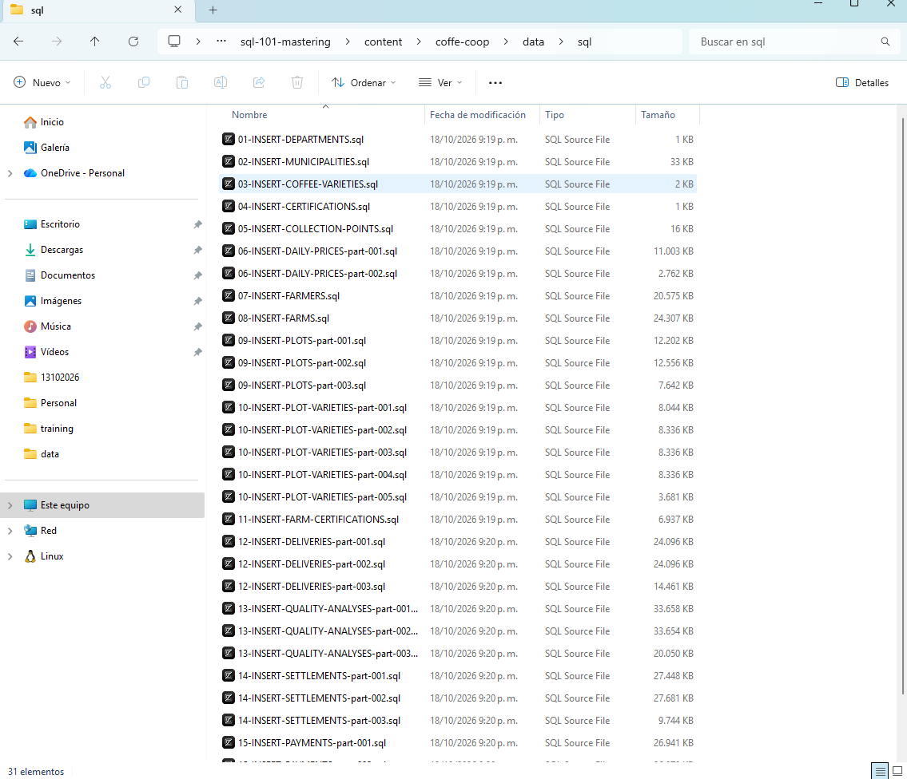
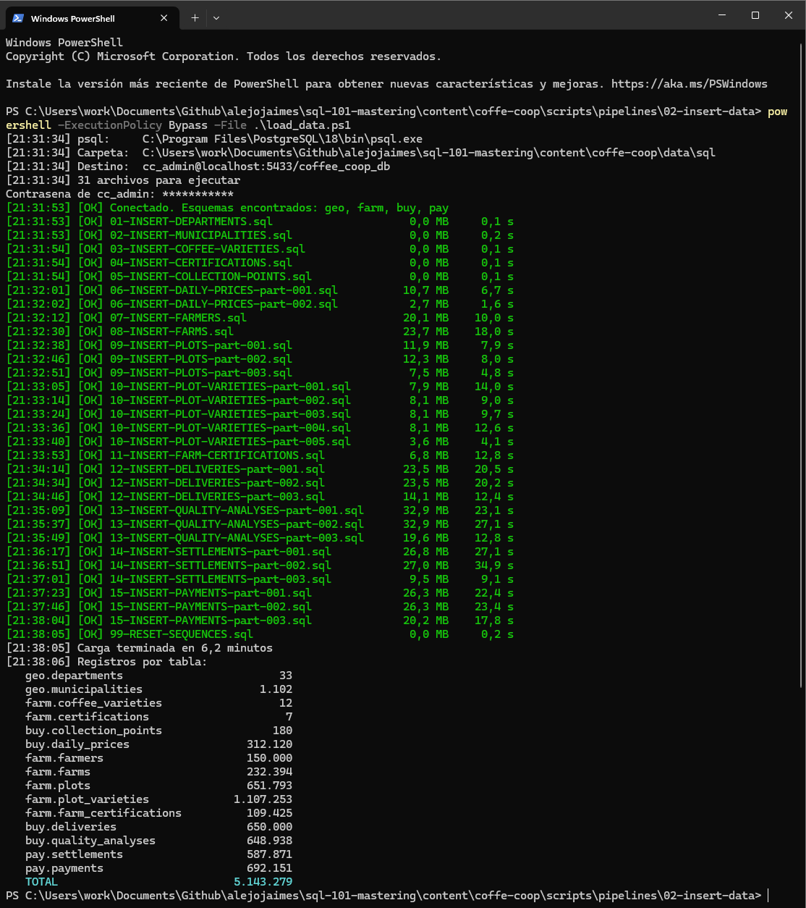
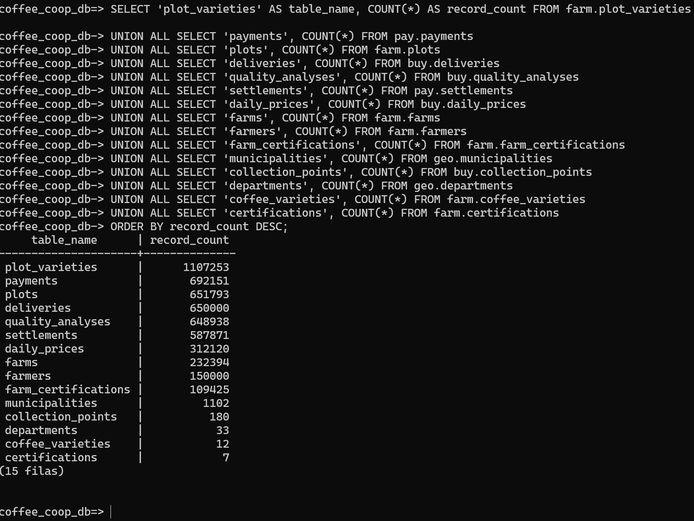

# Pipeline de Carga de Información Automatizada

Esta guía carga los ~5,1 millones de registros de `coffee_coop_db` desde Windows. Solo necesitas PostgreSQL instalado; no hace falta Python.

Los datos vienen comprimidos en `data/sql/coffee_coop_sql.zip`. Todos los comandos se ejecutan en PowerShell, desde la carpeta `content/coffee-coop` del repositorio.

```powershell
cd C:\ruta\a\sql-101-mastering\content\coffee-coop
```

> Si tu PostgreSQL usa otro puerto, cambia `5433` por el tuyo en todos los comandos.

## Paso 1. Descomprimir los datos

```powershell
Expand-Archive data\sql\coffee_coop_sql.zip -DestinationPath data\sql -Force
```

En `data\sql` deben quedar 31 archivos, desde `01-INSERT-DEPARTMENTS.sql` hasta `99-RESET-SEQUENCES.sql`.



## Paso 2. Crear la base de datos

Abre `scripts\ddl\01-create-database.sql` y haz el cambio de la contraseña antes de ejecutarlo:

1. Cambia `'*'` por la contraseña que está en classhub para `cc_admin`.

Luego ejecuta los tres scripts en orden. El primero pide la contraseña de `postgres` y los otros dos la de `cc_admin`:

```powershell
psql -U postgres -h localhost -p 5432 -f scripts\ddl\01-create-database.sql
psql -U cc_admin -h localhost -p 5432 -d coffee_coop_db -f scripts\ddl\02-create-tables.sql
psql -U cc_admin -h localhost -p 5432 -d coffee_coop_db -f scripts\ddl\03-alter-tables.sql
```

> Si PowerShell no reconoce `psql`, usa la ruta completa: `& "C:\Program Files\PostgreSQL\18\bin\psql.exe"`.

## Paso 3. Cargar los datos

```powershell
cd scripts\pipelines\02-insert-data
powershell -ExecutionPolicy Bypass -File .\load_data.ps1
```

El script pide la contraseña de `cc_admin` y carga los archivos en orden. Cada archivo se guarda en su propia transacción. La carga completa tarda entre 3 y 10 minutos.



## Paso 4. Validar

Entra a la base:

```powershell
psql -U cc_admin -h localhost -p 5432 -d coffee_coop_db
```

Y ejecuta:

```sql
SELECT 'plot_varieties' AS table_name, COUNT(*) AS record_count FROM farm.plot_varieties
UNION ALL SELECT 'payments', COUNT(*) FROM pay.payments
UNION ALL SELECT 'plots', COUNT(*) FROM farm.plots
UNION ALL SELECT 'deliveries', COUNT(*) FROM buy.deliveries
UNION ALL SELECT 'quality_analyses', COUNT(*) FROM buy.quality_analyses
UNION ALL SELECT 'settlements', COUNT(*) FROM pay.settlements
UNION ALL SELECT 'daily_prices', COUNT(*) FROM buy.daily_prices
UNION ALL SELECT 'farms', COUNT(*) FROM farm.farms
UNION ALL SELECT 'farmers', COUNT(*) FROM farm.farmers
UNION ALL SELECT 'farm_certifications', COUNT(*) FROM farm.farm_certifications
UNION ALL SELECT 'municipalities', COUNT(*) FROM geo.municipalities
UNION ALL SELECT 'collection_points', COUNT(*) FROM buy.collection_points
UNION ALL SELECT 'departments', COUNT(*) FROM geo.departments
UNION ALL SELECT 'coffee_varieties', COUNT(*) FROM farm.coffee_varieties
UNION ALL SELECT 'certifications', COUNT(*) FROM farm.certifications
ORDER BY record_count DESC;
```

Resultado esperado:

```
     table_name      | record_count
---------------------+--------------
 plot_varieties      |      1107253
 payments            |       692151
 plots               |       651793
 deliveries          |       650000
 quality_analyses    |       648938
 settlements         |       587871
 daily_prices        |       312120
 farms               |       232394
 farmers             |       150000
 farm_certifications |       109425
 municipalities      |         1102
 collection_points   |          180
 departments         |           33
 coffee_varieties    |           12
 certifications      |            7
(15 rows)
```

Son 5.143.279 registros en total.



## Si un archivo falla

El script revierte solo ese archivo, se detiene y te dice desde dónde seguir. Los archivos anteriores ya quedaron guardados. Corrige el problema y retoma con `-StartFrom`:

```powershell
powershell -ExecutionPolicy Bypass -File .\load_data.ps1 -StartFrom 08-INSERT-FARMS
```

| Mensaje | Qué hacer |
|---|---|
| `No se encontro psql` | Agrega `-PsqlPath "C:\Program Files\PostgreSQL\18\bin\psql.exe"` |
| `No fue posible conectarse` | Revisa la contraseña de `cc_admin`, el puerto y que el servicio de PostgreSQL esté corriendo |
| `Faltan esquemas` | Te faltó ejecutar `02-create-tables.sql` o `03-alter-tables.sql` (Paso 2) |
| `Las tablas ya tienen datos` | Ya cargaste antes. Borra la base, créala de nuevo (Paso 2) y vuelve a cargar |
| `duplicate key value` | Estás cargando un archivo que ya entró. Retoma desde el siguiente |

Para empezar de cero, conectado como `postgres`:

```sql
DROP DATABASE IF EXISTS coffee_coop_db;
DROP USER IF EXISTS cc_admin;
```
